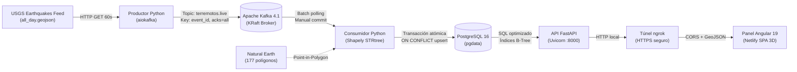

# Observatorio de Actividad Sísmica

> **Sistemas de Big Data · Consolidación de las sesiones 1–8 · RA1**  
> Pipeline distribuido de ingesta en streaming, enriquecimiento geoespacial, persistencia transaccional y visualización 3D interactiva de terremotos.

[](https://github.com/Almucero/observatorio-sismico)
[](https://observatorio-sismico-almucero.netlify.app)
[](compose.yaml)
[](http://127.0.0.1:8000/api/salud)
[](https://observatorio-sismico-almucero.netlify.app)

---

## 1. Presentación y Propósito del Proyecto

El **Observatorio de Actividad Sísmica** es una solución integral orientada a responder a la pregunta fundamental del proyecto:

> **¿Dónde se está registrando actividad sísmica en tiempo real y cómo se compara con un periodo histórico equivalente?**

Para dar respuesta rigurosa a esta cuestión, el sistema combina:
1. **Extracción continua:** Sondeo automatizado cada 60 segundos del feed de eventos recientes de USGS (ventana móvil de 24 horas).
2. **Histórico de referencia:** Catálogo completo de 2025 con magnitud $\ge 4$ obtenido de FDSN-WS (18.302 terremotos de USGS y más de 27.000 unificando agencias regionales).
3. **Enriquecimiento geográfico espacial:** Determinación del país y subregión mediante operaciones de *Point-in-Polygon* (STRtree de Shapely) con las fronteras vectoriales de Natural Earth, preservando la categoría *«Sin país asignado»* para eventos marítimos.
4. **Calidad y consistencia transaccional:** Tratamiento explícito de valores nulos, magnitudes y profundidades anómalas, aislamiento en cuarentena de geometrías inválidas y tolerancia total a reintentos de Kafka mediante *escritura idempotente* en PostgreSQL.
5. **Visualización y análisis:** Panel interactivo desplegado en Netlify con globo terráqueo 3D interactivo, tarjetas de detalle, filtros sincronizados, series temporales por ventanas de 1 hora UTC, distribuciones estadísticas y comparación cuantitativa frente a la media diaria histórica de 2025.

---

## 2. Accesos Rápidos

| Recurso | Destino / Acceso | Descripción |
|---|---|---|
| **Repositorio oficial** | [github.com/Almucero/observatorio-sismico](https://github.com/Almucero/observatorio-sismico) | Código fuente, configuración Docker, esquemas SQL y documentación. |
| **Panel público (Netlify)** | [observatorio-sismico-almucero.netlify.app](https://observatorio-sismico-almucero.netlify.app) | SPA pública con globo 3D, filtros, métricas y modo resiliencia (*fallback offline*). |
| **API pública (ngrok)** | `https://jasmine-unpainted-oat.ngrok-free.dev` | Túnel seguro HTTPS hacia el servicio FastAPI local (`:8000`). |
| **Salud de la API (local)** | [http://127.0.0.1:8000/api/salud](http://127.0.0.1:8000/api/salud) | Comprobación de conectividad, última ingesta y estado de fuentes. |

---

## 3. Mapa de Navegación Documental

El repositorio cuenta con una documentación estructurada y enlazada para facilitar la revisión del código y la evaluación de cada criterio:

```
Terremotos/
├── README.md                          <-- Esta guía general del proyecto
└── docs/
    ├── README.md                      <-- Índice general de documentación
    ├── memoria.md                     <-- Memoria técnica completa (10 apartados de rúbrica)
    ├── DESPLIEGUE.md                  <-- Guía paso a paso de Netlify y túnel ngrok
    ├── entregables-checklist.md       <-- Lista de comprobación canónica frente a rúbrica
    ├── USO-SPECKIT.md                 <-- Metodología y trazabilidad con Spec Kit
    ├── requisitos/                    <-- Normativa oficial del proyecto
    │   ├── README.md                  <-- Índice de requisitos oficiales
    │   ├── ENUNCIADO.md               <-- Enunciado formal y rúbrica oficial (§13)
    │   ├── CONTRATO-API.md            <-- Especificación de endpoints GeoJSON y estadísticas
    │   ├── GUIA-ENTREGABLES.md        <-- Estructura de entrega y criterios de evaluación
    │   ├── FAQ-ALUMNADO.md            <-- Preguntas frecuentes y aclaraciones de diseño
    │   ├── FUENTES-Y-LICENCIAS.md     <-- Licencias de datos (USGS, Natural Earth)
    │   └── VALIDACION.md              <-- Verificación y límites del material base
    └── evidencias/                    <-- Evidencias empíricas y capturas
        ├── README.md                  <-- Índice de artefactos y pruebas de aceptación
        ├── calidad.json               <-- Métricas de las 6 dimensiones de calidad
        ├── idempotencia.json          <-- Verificación de upsert e idempotencia
        ├── duplicados-fuentes.json    <-- Resultados de deduplicación multi-fuente
        ├── tunel-down-up.md           <-- Prueba de corte y reconexión del túnel
        └── capturas/                  <-- Capturas del panel en producción (1080p)
```

### ¿Qué documento consultar según la necesidad?

- **Para entender la norma, rúbrica y contrato:** Consultar [`docs/requisitos/README.md`](docs/requisitos/README.md) y [`docs/requisitos/ENUNCIADO.md`](docs/requisitos/ENUNCIADO.md).
- **Para evaluar los 5 criterios de la rúbrica (Nivel Sobresaliente):** Leer [`docs/memoria.md`](docs/memoria.md) (extracción §1, diccionario §2, calidad §3, modelado §4, análisis e insights §5, complejidad y costes §6).
- **Para verificar la lista final de comprobación:** Revisar [`docs/entregables-checklist.md`](docs/entregables-checklist.md).
- **Para reproducir el despliegue en Netlify y ngrok:** Seguir [`docs/DESPLIEGUE.md`](docs/DESPLIEGUE.md).
- **Para comprobar las pruebas de aceptación y fallos controlados:** Explorar [`docs/evidencias/README.md`](docs/evidencias/README.md).

---

## 4. Arquitectura y Flujo de Datos

El sistema respeta estrictamente la arquitectura obligatoria de **cinco servicios aislados en Docker Compose** comunicados mediante una red interna, sin requerir clústeres externos pesados:



### Componentes y Responsabilidades

| Servicio | Tecnología | Rol y Responsabilidad | Ubicación / Puerto |
|---|---|---|---|
| **Productor** | Python 3.12 + `aiokafka` | Sondeo periódico de USGS, filtrado de tipo y publicación en Kafka con clave `event_id`. | Contenedor `producer` |
| **Broker** | Apache Kafka 4.1 (KRaft) | Transporte persistente, particionado por clave y retención temporal de mensajes. | Contenedor `kafka` (`:9092`) |
| **Consumidor** | Python 3.12 + `shapely` | Validación de datos, asignación espacial de país y persistencia transaccional. | Contenedor `consumer` |
| **Base de Datos** | PostgreSQL 16 (Alpine) | Almacenamiento relacional (historial inmutable `evento_version` y estado `evento_actual`). | Contenedor `postgres` (`:5432`) |
| **API** | Python 3.12 + `FastAPI` | Exposición de endpoints `/api/salud`, `/api/eventos` y `/api/estadisticas`. | Contenedor `api` (`:8000`) |
| **Túnel** | ngrok Agent | Publicación pública HTTPS segura con certificado gestionado hacia la API local. | Host anfitrión |
| **Frontend** | Angular 19 + Three.js | Visualización cartográfica 3D (globo terráqueo), widgets interactivos y fallback de resiliencia. | Netlify (SPA pública) |

---

## 5. Estructura del Repositorio de Código

```
Terremotos/
├── api/                   # Código del servicio FastAPI
│   ├── main.py            # Endpoints REST, CORS, metadata OpenAPI y control de errores
│   └── models.py          # Modelos Pydantic del contrato GeoJSON y respuestas
├── common/                # Código compartido entre servicios Python
│   ├── db.py              # Pool de conexiones asíncrono y transacciones PostgreSQL
│   └── settings.py        # Configuración centralizada vía pydantic-settings
├── consumer/              # Código del servicio Consumidor
│   ├── main.py            # Bucle de consumo aiokafka, commit manual e idempotencia
│   ├── geo.py             # Enriquecimiento espacial Point-in-Polygon con STRtree
│   └── validator.py       # Reglas de calidad y desvío a cuarentena
├── producer/              # Código del servicio Productor
│   ├── main.py            # Extracción del feed continuo de USGS (60s)
│   ├── history.py         # Descarga masiva del histórico FDSN 2025 M≥4
│   ├── replay.py          # Reproductor acelerado de eventos históricos
│   └── sources/           # Adaptadores para fuentes adicionales (ampliación)
├── frontend/              # Aplicación Angular 19
│   ├── src/app/           # Componentes: Globo 3D, filtros, tabla y métricas
│   ├── public/config.json # Configuración de endpoint ngrok / local
│   └── netlify/           # Funciones serverless para modo desconectado
├── sql/                   # Scripts de inicialización y esquemas de base de datos
│   ├── 01_schema.sql      # Esquema principal (evento_actual, evento_version, cuarentena)
│   ├── 02_replay_schema.sql # Esquema aislado para reproducción histórica
│   ├── 03_consulta_fdsn.sql # Control de ingesta histórica
│   └── 04_fuentes.sql     # Soporte de deduplicación multi-fuente
├── compose.yaml           # Definición de los 5 servicios Docker Compose
├── Dockerfile             # Imagen reproducible para producer, consumer y api
└── .env.example           # Plantilla de variables de entorno sin credenciales
```

---

## 6. Puesta en Marcha (Instrucciones Reproducibles)

### Requisitos Previos
- **Docker Desktop** (con backend WSL2 habilitado en Windows).
- **Git** (cliente de línea de comandos).
- **Node.js** (v18+ o v22 LTS) y `npm` (solo para desarrollo frontend local).
- **ngrok** (cliente CLI instalado mediante `winget install ngrok.ngrok` o desde [ngrok.com](https://ngrok.com/download)).

---

### A. Puesta en marcha desde cero (PC nuevo)

#### 1. Clonar el repositorio
```bash
git clone https://github.com/Almucero/observatorio-sismico.git
cd observatorio-sismico
```

#### 2. Configurar variables de entorno (`.env`)
Copiar la plantilla de ejemplo:
```bash
cp .env.example .env
```
*El archivo `.env.example` viene preconfigurado con valores seguros por defecto para los 5 servicios. Si dispones de cuenta ngrok, puedes incluir tu token en `NGROK_AUTHTOKEN`.*

#### 3. Construir y arrancar los 5 servicios Docker Compose
Asegúrate de que Docker Desktop está abierto y ejecuta:
```bash
docker compose up --build -d
```
- **Verificar que todos los servicios están saludables:**
  ```bash
  docker compose ps
  ```
  *(Los 5 contenedores `kafka`, `postgres`, `producer`, `consumer` y `api` deben figurar en estado `Up` y `healthy`).*
- **Comprobar la API localmente:**
  Abrir en el navegador [http://127.0.0.1:8000/api/salud](http://127.0.0.1:8000/api/salud).

#### 4. Levantar el túnel HTTPS con ngrok
En una ventana de terminal independiente:
```powershell
ngrok http 8000 --url https://jasmine-unpainted-oat.ngrok-free.dev
```
*(Al utilizar el dominio dev estático asignado, la URL nunca cambia y no requiere reconfigurar ni recompilar el frontend).*

#### 5. Abrir el panel frontend
- **En producción (Netlify):** Abrir directamente [https://observatorio-sismico-almucero.netlify.app](https://observatorio-sismico-almucero.netlify.app).
- **En local (opcional):**
  ```bash
  cd frontend
  npm ci
  npm start
  ```
  Acceder a [http://localhost:4200](http://localhost:4200).

---

### B. Puesta en marcha habitual (Sesión diaria o defensa)

Una vez configurado inicialmente, para reanudar el sistema solo se requieren **tres pasos**:

```bash
# 1. Levantar contenedores en segundo plano
docker compose up -d

# 2. Iniciar el túnel HTTPS (en otra terminal)
ngrok http 8000 --url https://jasmine-unpainted-oat.ngrok-free.dev

# 3. Abrir el panel en el navegador
# https://observatorio-sismico-almucero.netlify.app
```

Para detener el stack al finalizar la jornada:
```bash
docker compose down
```
*(Los datos persisten de forma segura en el volumen de Docker `pgdata`).*

---

## 7. Ingesta Histórica y Reproducción Acelerada (Replay)

### Carga del histórico de referencia (Año 2025, M $\ge$ 4)
Para cargar o regenerar los sismos históricos de 2025 de USGS:
```bash
docker compose run --rm --no-deps producer python -m producer.history --source usgs --year 2025 --min-mag 4
```

### Demostración con Replay Acelerado
Para demostrar el flujo en vivo sin esperar a que ocurra un sismo real durante la defensa:
```bash
docker compose run --rm --no-deps producer python -m producer.replay --limit 50 --speed 60
```
- **Aislamiento garantizado:** Se publica en el topic `terremotos.replay` y se almacena en el esquema aislado `replay.*`, etiquetado visiblemente como `REPRODUCCIÓN` en el panel, sin mezclar datos en vivo.

---

## 8. Mapeo de Evidencias de Evaluación (Rúbrica §13)

A continuación se resume la correspondencia entre los cinco criterios de la rúbrica oficial (nivel **Sobresaliente, 9–10**) y sus evidencias comprobables en el repositorio:

| Criterio | Requisito de Rúbrica | Evidencia en el Repositorio | Ubicación Detallada |
|---|---|---|---|
| **1. Extracción** | Carga continua y masiva, tipado estricto, unidades y gestión de cuotas. | Ingesta de USGS (`all_day.geojson`), FDSN 2025 (18.302 sismos) y 6 fuentes adicionales con backoff exponencial. | [`docs/memoria.md` §1](docs/memoria.md#1-extracción-y-procedencia) · [`sql/03_consulta_fdsn.sql`](sql/03_consulta_fdsn.sql) |
| **2. Calidad** | Análisis completo en 6 dimensiones con acciones de limpieza y cuarentena. | Validación de completitud, unicidad, validez, consistencia, actualidad y exactitud. Aislamiento de anomalías sin descarte ciego. | [`docs/memoria.md` §3](docs/memoria.md#3-calidad-6-dimensiones--acciones) · [`docs/evidencias/calidad.json`](docs/evidencias/calidad.json) |
| **3. Modelado** | Modelo relacional optimizado, claves, integración geográfica e idempotencia. | Esquema con separación de hechos y versiones (`evento_actual`, `evento_version`). Índices B-Tree compuestos y Point-in-Polygon espacial. | [`docs/memoria.md` §4](docs/memoria.md#4-modelo-conceptual--lógico--físico) · [`sql/01_schema.sql`](sql/01_schema.sql) |
| **4. Análisis** | Agregaciones temporales, distribuciones, comparación histórica y $\ge 3$ conclusiones. | Ventanas fijas de 1h UTC, distribución de magnitud/profundidad, comparación de 24h vs. media 2025 y 3 conclusiones fundamentadas. | [`docs/memoria.md` §5](docs/memoria.md#5-análisis-3-conclusiones) · [`docs/evidencias/capturas/`](docs/evidencias/capturas/) |
| **5. Reflexión** | Complejidad algorítmica ($O$), mediciones en 3 tamaños, escalado a $10^8$ y costes. | Coste formal de 3 operaciones clave, benchmarks empíricos en 3 volúmenes, proyección a 100M filas, desglose de costes y 3 mejoras. | [`docs/memoria.md` §6](docs/memoria.md#6-complejidad-mediciones-costes-mejoras) · [`docs/entregables-checklist.md`](docs/entregables-checklist.md) |

---

## 9. Guion para la Defensa Oral y Presentación en Vídeo

Para la grabación del vídeo o defensa ante el tribunal ([`GUIA-ENTREGABLES.md` §3.3](docs/requisitos/GUIA-ENTREGABLES.md#33-explicación-individual)):

1. **Recorrido del evento de principio a fin:**
   - *Extracción:* El productor extrae el feed de USGS y comprueba `publicado` para evitar reenvíos.
   - *Transporte:* Kafka transporta el mensaje en `terremotos.live` con partición por clave `event_id` y acuse `acks=all`.
   - *Validación y Cuarentena:* El consumidor verifica tipos y desvía eventos no sísmicos a `cuarentena`.
   - *Enriquecimiento Espacial:* Cruce espacial Point-in-Polygon (STRtree) con Natural Earth asignando código `ADM0_A3` o `null` si es oceánico.
   - *Persistencia Transaccional:* Inserción atómica en `evento_version` y upsert condicional en `evento_actual`.
   - *Commit Manual:* El offset en Kafka se confirma únicamente tras el commit en base de datos.
   - *Visualización:* FastAPI sirve los datos vía ngrok hacia el panel Angular en Netlify para su renderizado 3D interactivo.
2. **Decisión técnica propia a destacar:**
   - **Semántica At-Least-Once con Idempotencia Transaccional:** Se prescindió de transacciones distribuidas complejas (XA/2PC) combinando el commit manual tras escritura en base de datos con una clave compuesta `(event_id, updated)` y un upsert condicional en SQL. Esto garantiza tolerancia absoluta ante caídas de procesos sin duplicar conteos ni corromper agregaciones.

---

## 10. Licencias y Fuentes de Datos

- **Sismicidad:** [USGS Earthquake Hazards Program](https://earthquake.usgs.gov/) (Dominio público, U.S. Government Work).
- **Fronteras y Geografía:** [Natural Earth](https://www.naturalearthdata.com/) (Dominio público / Public Domain).
- **Código del Proyecto:** Desarrollado bajo fines educativos para el Curso de Especialización en Inteligencia Artificial y Big Data (IABD). Licencia MIT.
